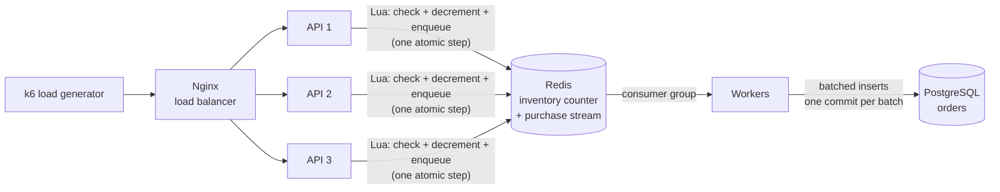

# DropExpert

**A horizontally scalable flash-sale backend.** 10,000 buyers try to purchase 1,000 units within a few seconds. The system never oversells, answers buyers in milliseconds, keeps the database out of the burst, and keeps working when an API server or a worker crashes.

This is a systems project, not a shop. There are no accounts, carts, or payments. The point is the engineering underneath a flash sale: horizontal scaling, coordinating shared state, atomic operations under contention, asynchronous processing, and failure recovery. 

**Stack:** Java 21 · Spring Boot · Redis (Lua scripts, Streams) · PostgreSQL · Nginx · Docker Compose 

---

## Architecture

## Life of a purchase

1. A buyer sends `POST /api/drops/1/purchase` with `{"userId": "..."}`.
2. Nginx forwards the request to one of the API instances.
3. The API generates a purchase ID and runs `reserve.lua` in Redis. In one uninterruptible step, the script checks stock, decrements it, and appends the purchase to the stream.
4. The API responds right away:
   - **`202 PROCESSING`** with the purchase ID if a unit was reserved.
   - **`409 SOLD_OUT`** if not. Sold-out requests never touch the database.
5. A worker reads a batch of up to 50 purchases, inserts them all in one transaction, and only then acknowledges them.

| Component | Responsibility |
|---|---|
| **Nginx** | Single entry point. Round-robins requests across API instances and routes around dead ones. |
| **API (×3)** | Stateless Spring Boot instances. Each one decides *accepted* or *sold out* by running one atomic Lua script in Redis, then answers immediately. |
| **Redis: inventory** | One shared counter (`drop:1:remaining`). The single source of truth for "how many are left." |
| **Redis: stream** | A queue (`purchases`) of accepted purchases waiting to be saved. It decouples the burst of buyers from the database. |
| **Workers** | The same codebase, started with `APP_ROLE=worker`. They read the stream through a consumer group, save orders in batches, and rescue work left behind by crashed workers. |
| **PostgreSQL** | The durable record of every order. A unique `purchase_id` makes repeated saves harmless. |

## Key design decisions 

**Horizontal scaling and load balancing: handling the burst.**
A flash sale sends far more requests in a few seconds than one server can handle comfortably. Instead of one bigger server, DropExpert runs several identical API instances behind Nginx, which spreads requests across them in turn (round-robin). Adding an instance adds capacity

**Stateless services with shared external state: any server can handle any request.**
The API instances keep nothing important in their own memory. The inventory count lives in Redis and orders live in PostgreSQL, so every instance sees the same data, and an instance can be added, removed, or crash without losing anything. If each server kept its own count, three servers would sell from three different counts.

**Atomicity: no overselling.**
"Read the count, check it's above zero, subtract one" is three steps. When many requests overlap, several can read the same count before any of them subtracts, and all of them succeed. That's a race condition, and it oversold even on a single server. DropExpert runs the check, the decrement, and the enqueue as one Lua script inside Redis. Redis runs a script without letting any other command in between, so the decision can't be interrupted, and inventory can never go below zero.

**Asynchronous processing with a message queue: load leveling.**
Saving an order is slow compared with deciding whether a buyer got a unit. So the API only makes the decision. It puts accepted purchases into a queue and answers right away. Workers take purchases off the queue and save them to PostgreSQL at their own pace. The queue absorbs the spike, so the database never has to handle the whole burst at once.

**At-least-once delivery and idempotency: no lost or duplicate orders.**
A worker saves an order first and acknowledges it second. If it crashes in between, the purchase is delivered again rather than lost. Delivering again is harmless, because each order has a unique `purchase_id` and the insert uses `ON CONFLICT DO NOTHING`: a repeat is simply skipped. Together, this gives exactly one order per purchase, without the complexity of exactly-once delivery.

**Fault tolerance: surviving a server crash.**
Because there are several interchangeable API instances, losing one doesn't stop the sale. Nginx notices a dead instance when requests to it fail, skips it for a while, and sends traffic to the others. 

**Failure recovery: finishing a crashed worker's work.**
Redis tracks every purchase a worker has received but not yet acknowledged. If a purchase stays unfinished for more than 10 seconds, another worker assumes its owner died, claims it, and saves it. Redis hands each claimed purchase to only one worker, and because saving is idempotent, it's safe even if the original worker was just slow.

---

## How the design evolved

The system was built in stages. 

### Stage 1: The simplest version oversells, even on one server

One Spring Boot instance with inventory in PostgreSQL, written the obvious way: read the count, check that it's above zero, subtract one, save the order. One server still handles many requests at once on different threads. They read the same count, and each overwrites the others' subtraction. That's a *lost update*. 

### Stage 2: Three servers and a shared counter still oversell, but only slightly

Three stateless API instances behind Nginx, with the inventory moved into Redis so all instances share one count. The check-then-act was still naive: `GET`, check, then `DECR`. Each Redis command is atomic on its own, so no subtraction is ever lost anymore. But the gap *between* `GET` and `DECR` remains, and a handful of requests that all read "1" near the end all succeed. 

### Stage 3: An atomic Lua script means exactly 1,000 sold

Moving read, check, and decrement into one Lua script made the whole decision indivisible. No more overselling. 

### Stage 4: A queue protects the database

Orders were still being saved during the request, so every successful buyer waited on PostgreSQL. The Lua script was extended to also append each accepted purchase to a Redis Stream, in the same atomic step. That way, a unit can never be taken without its order being queued. The API now returns `202` immediately, and workers save orders in the background.

This made the API faster at every server count. But saving orders was still slow, and adding more workers didn't fix it. The reason: each order was saved in its own transaction, and every transaction has to wait for the disk before it finishes. Saving each batch of up to 50 orders in one transaction removed most of that waiting and made saving much faster.

### Stage 5: Breaking it on purpose

- **API crash:** one of three API servers was killed during steady traffic. Only the handful of requests that were inside the dying server failed. Nginx sent everything else to the survivors. **0 oversold, 0 lost orders.**
- **Worker crash before saving:** a worker died holding 50 unsaved purchases. A healthy worker detected them as stuck and claimed and saved them. All 1,000 orders were saved.
- **Worker crash after saving, before acknowledging:** the rescued purchases were reprocessed, and the database skipped them as already saved. 

---

## Limitations

- Redis and PostgreSQL are single instances, so either one going down stops the sale.
- Everything runs on one machine. A real deployment would spread the servers across hosts.
- A buyer whose request was inside a crashing server gets an error and can't tell whether the purchase went through. A client-supplied idempotency key would make retries safe.